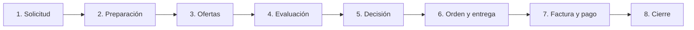
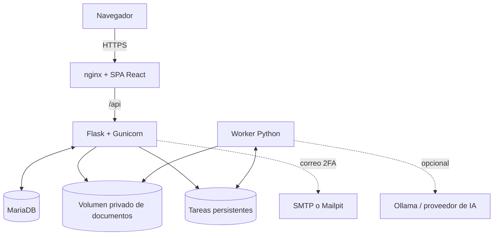

# Compras Públicas Lavalleja

Portal de compras públicas de Lavalleja y escritorio de gestión de expedientes. Los proveedores consultan llamados y presentan ofertas. La Intendencia tramita cada compra desde la solicitud hasta el pago y puede publicar la resolución y sus fundamentos.

> Estado: el núcleo está implementado y verificado localmente. Antes de operar con datos institucionales reales deben validarse el despliegue, el SMTP, el almacenamiento definitivo, las reglas jurídicas, las integraciones oficiales y la política de IA.

## Qué resuelve

- Centraliza los datos, actuaciones y documentos de cada expediente.
- Ofrece un catálogo público con búsqueda por título, área o código y filtros por estado. Cada llamado tiene un enlace permanente y un formulario propio.
- Recibe ofertas por renglón con precios, impuestos, flete, plazo, garantía, descripción técnica y un adjunto opcional. La presentación confirma el correo del proveedor y entrega un comprobante.
- Publica el pliego seleccionado y la versión documental autorizada. Los sobres y sus anexos quedan reservados hasta la apertura.
- Permite consultar una recomendación de IA sobre las ofertas admisibles y publicar el fundamento de la resolución humana, incluido un eventual apartamiento.
- Publica al cliente solo las acciones válidas para el estado y el rol del usuario.
- Registra la trazabilidad de cambios, decisiones, evidencias y responsables.
- Evalúa ofertas con un motor determinista, sin depender de IA.
- Permite simulaciones aisladas que no modifican el expediente.
- Controla acceso por asignación vigente, área, vigencia y competencia.
- Mantiene documentos privados, versionados y con hash SHA-256.
- Verifica la integridad de una cadena append-only de eventos de auditoría.
- Expone estados honestos para integraciones: manual, no configurada o conectada; no simula conexiones exitosas.

La aplicación **no decide jurídicamente** por sí sola: bloquea o advierte cuando faltan datos, competentes, reglas o evidencia. Los actos institucionales, firmas, pagos y registros en sistemas externos siguen requiriendo su circuito autorizado.

## Flujo funcional

Cada expediente avanza por ocho etapas visibles:



El servidor controla las transiciones. Un usuario no puede enviar una etapa arbitraria desde el navegador.

1. **Solicitud:** crear borrador, completar renglones y fundamentación, y enviar para recepción.
2. **Preparación:** recibir, clasificar, registrar disponibilidad, aprobar pliego, autorizar convocatoria, publicar y seleccionar el marco aplicable.
3. **Ofertas:** registrar sobres y apertura; cargar ofertas y revisar requisitos. La apertura separa datos reservados de la lectura general.
4. **Evaluación:** ejecutar el motor, revisar resultados, explicar el cálculo y enviar el dictamen para decisión.
5. **Decisión:** registrar intervenciones de asesoría o control, responder observaciones y adjudicar cuando corresponda.
6. **Orden y entrega:** comunicar, formalizar contratos, emitir orden y registrar recepción.
7. **Factura y pago:** registrar factura, conformidad, control presupuestario, autorización y pago.
8. **Cierre:** completar el expediente una vez satisfechas las condiciones del estado anterior.

Además existen ramas explícitas para **cancelación, procedimiento desierto, rechazo de ofertas, revisión de excepción y reinicio**. Estas ramas conservan evidencia y no borran la historia.

### Evaluación de ofertas

El motor de evaluación de [backend/app/modules/evaluation/engine.py](backend/app/modules/evaluation/engine.py) es puro y versionado:

- usa `Decimal`, no punto flotante, para importes y puntajes;
- separa monto comercial, comparable, adjudicable y pagadero;
- admite evaluación ponderada, mínimo precio y convenio marco;
- distingue `cumple`, `no cumple` y `pendiente`;
- no convierte ausencia de evidencia en incumplimiento;
- bloquea empates, preferencias no parametrizadas, adjudicación parcial no automatizada o datos críticos pendientes;
- permite un escenario aislado sin persistencia;
- produce una trazabilidad reproducible del cálculo.

Con un proveedor Ollama habilitado, el evaluador puede solicitar una recomendación adicional de IA. El modelo compara alias de ofertas admisibles, puede proponer una o abstenerse y devuelve un fundamento. Se conserva la primera respuesta válida para esa evaluación. La adjudicación corresponde al ordenador competente.

### Usar el portal

| Ruta | Uso |
|---|---|
| `/` | Buscar convocatorias y filtrar por estado. |
| `/licitaciones/:id` | Consultar el detalle, los renglones, los criterios, el plazo y, si corresponde, el resultado. El identificador es el código del expediente. |
| `/licitaciones/:id/ofertar` | Identificar al proveedor, cotizar y confirmar con el código enviado por correo. |
| `/resultados` | Consultar las adjudicaciones publicadas, sus importes y sus fundamentos. |
| `/gestion` | Ingresar al escritorio del personal municipal. |

1. En el escritorio, creá una solicitud e indicá qué necesitás, los renglones y al menos un requisito mínimo. En preparación, editá el pliego, fijá el cierre en hora de Uruguay y elegí **Portal público de Lavalleja** como canal de recepción.
2. Completá el encuadre, la disponibilidad, la aprobación del pliego y la autorización del llamado con los roles correspondientes. En la acción de publicidad elegí **Convocatoria** y la publicación en el portal. Podés incorporar una versión específica del documento de pliego.
3. El proveedor abre el enlace del llamado, completa las tres etapas y conserva el comprobante. Un proveedor existente debe utilizar su correo registrado. El personal autorizado puede actualizarlo en **Proveedores** con una referencia de respaldo. La comprobación del buzón y la verificación en RUPE son controles distintos.
4. Tras el cierre, registrá el acta de apertura. Las ofertas digitales alimentan el comparador con los datos originales. Revisá los requisitos y calculá la evaluación. Para obtener el criterio del modelo, elegí **Solicitar recomendación de IA** antes de adjudicar.
5. Registrá el dictamen, los controles y la resolución. Si la elección difiere de una recomendación, indicá el motivo. En **Publicar resultado en el portal**, revisá los datos públicos y la recomendación inicial de IA si existe. El resultado queda disponible en el mismo enlace del llamado.

La organización del catálogo, las fichas y las rutas por convocatoria sigue [Lavalleja Concursa](https://github.com/NebyX1/lavalleja-concursa). El formulario por etapas y la revisión previa al envío toman como referencia [Hogares estudiantiles](https://github.com/IntendenciaDeLavalleja/hogares-frontend). El escudo de la Intendencia y el favicon se copiaron de los [recursos originales de Hogares estudiantiles](https://github.com/IntendenciaDeLavalleja/hogares-frontend/tree/c6346a04474585e2102c60703a1c492e3a6cc91a/public).

### Identidad, permisos y documentación

- Roles: solicitante, compras, contaduría, técnica, comisión, control, ordenador, recepción, tesorería, auditor y administrador.
- Cada permiso nace de una asignación vigente con área, fechas, topes y procedimientos habilitados cuando aplica.
- Autenticación normal con contraseña Argon2, captcha, segundo factor por correo, bloqueo temporal e invalidación de sesión.
- Protección CSRF, limitación de peticiones, controles de concurrencia, versionado optimista e idempotencia.
- Documentos con acceso autorizado, versiones inmutables para sobres, nombres internos opacos y descarga auditada.
- Auditoría por evento con hash del contenido y del evento anterior; puede verificarse y exportarse a CSV.

El override local activa únicamente para pruebas una sesión sintética de Compras en el área `Pruebas locales`. Esta excepción requiere simultáneamente `APP_ENV=testing` y `LOCAL_TEST_AUTH=true`; no existe en el compose de producción.

## Arquitectura



Servicios de Docker Compose:

| Servicio | Responsabilidad | Puerto publicado |
|---|---|---|
| `web` | nginx, SPA y proxy `/api` hacia backend | Solo el override local publica `127.0.0.1:8080` |
| `backend` | API Flask/Gunicorn, permisos, dominio, evaluación, autenticación y documentos | Solo interno: `5006` |
| `worker` | Cola persistente: ingesta documental y extracción asistida | No |
| `migrate` | Espera la DB, ejecuta Alembic y carga la configuración base; luego termina | No |
| `db` | MariaDB 11.4 | No |
| `mailpit` | Buzón SMTP/UI para pruebas, perfil `local` | `127.0.0.1:8025` con override |

Los volúmenes `db-data`, `documents` y `models` conservan datos entre reinicios. **No usar `docker compose down -v`** en un entorno que contenga datos útiles.

## Tecnologías

- **Backend:** Python 3.11, Flask 3, SQLAlchemy 2, Alembic/Flask-Migrate, Gunicorn.
- **Persistencia:** MariaDB 11.4; migraciones SQLAlchemy/Alembic.
- **Frontend:** React 19, TypeScript, Vite 6, Fluent UI React v9 (Fluent 2), React Router, TanStack Query, React Hook Form, Axios y Zustand. El tema claro y el nocturno se pueden alternar desde el encabezado.
- **Entrega:** Docker Compose, nginx 1.27, imágenes Alpine/SLIM.
- **Seguridad:** Flask-Login, Argon2, CSRF, 2FA por correo, cookies y cabeceras endurecidas.
- **Documentos:** almacenamiento local privado en compose; adaptador MinIO disponible en código pero no conectado al stack.
- **IA opcional:** Ollama, FastEmbed, RAG normativo e ingesta persistente mediante worker.
- **Pruebas:** pytest; TypeScript; build Vite. El proyecto también incluye dependencias de Playwright para pruebas E2E.

## Inicio rápido en otra PC

### Requisitos

- Git.
- Docker Desktop o Docker Engine con Compose v2.
- En Windows: PowerShell 5.1 o superior.
- Puerto local `8080` libre, o cambiar `LOCAL_HTTP_PORT`.
- Acceso a Internet durante la primera construcción para descargar imágenes y dependencias.

### Windows / PowerShell

Ejecutar desde la raíz:

```powershell
git clone https://github.com/NebyX1/gestion-de-compras.git
Set-Location gestion-de-compras

# Crea .env privado con secretos aleatorios; no sobrescribe uno existente.
.\scripts\Initialize-Environment.ps1

# Construye y levanta MariaDB, migraciones, backend, worker y web.
.\scripts\Start-Stack.ps1 -WithMail

# Verifica servicios y endpoints.
.\scripts\Test-Stack.ps1
```

Abrir:

- aplicación: <http://127.0.0.1:8080>;
- correo de pruebas: <http://127.0.0.1:8025>;
- salud pública: <http://127.0.0.1:8080/healthz>.

La portada es pública. En el override local, **Acceso interno** abre el escritorio de Compras en `Pruebas locales`. Usá Mailpit para leer los códigos de presentación de prueba. En un despliegue institucional, configurá el SMTP real.

### Docker Compose directo, sin PowerShell

```sh
cp .env.example .env
# Completar SECRET_KEY, MARIADB_ROOT_PASSWORD y MARIADB_PASSWORD con valores fuertes.
docker compose -f docker-compose.yml -f docker-compose.local.yml --profile local up -d --build
curl http://127.0.0.1:8080/healthz
curl http://127.0.0.1:8080/api/v1/health/live
```

En PowerShell es preferible `Initialize-Environment.ps1`, que genera los secretos localmente.

### Autenticación normal

Para crear un administrador real y abandonar el acceso sintético, usar el compose sin el override local o desactivar `LOCAL_TEST_AUTH`:

```powershell
docker compose -f docker-compose.yml -f docker-compose.local.yml exec backend `
  flask --app wsgi create-admin `
  --username admin `
  --email admin@example.org `
  --full-name "Administrador"
```

La consola solicita la contraseña de forma segura. El usuario deberá cambiarla en su primer ingreso.

## Variables y secretos

[.env.example](.env.example) es la referencia completa. Las variables se agrupan en:

- red y origen público;
- base de datos;
- secretos y sesión;
- autenticación y correo;
- documentos y, si se habilita en otro entorno, MinIO;
- proveedor de IA y política de egreso;
- puertos locales.

Nunca versionar `.env`, claves, contraseñas, copias de bases o documentos. `.gitignore` ya excluye estos archivos. `Initialize-Environment.ps1 -Force` reemplaza secretos existentes y puede dejar datos previos inaccesibles; no usarlo en un entorno con datos.

## Desarrollo y pruebas

### Stack ejecutándose

```powershell
.\scripts\Run-Tests.ps1
.\scripts\Test-Stack.ps1
```

El script de pruebas espera `backend\.venv\Scripts\python.exe` para pytest y `frontend\node_modules` para el build. Si el entorno local aún no está preparado:

```powershell
Set-Location backend
python -m venv .venv
.\.venv\Scripts\python.exe -m pip install -r requirements-dev.txt
Set-Location ..\frontend
npm ci
Set-Location ..
```

Comandos unitarios:

```powershell
Set-Location backend
.\.venv\Scripts\python.exe -m pytest -q

Set-Location ..\frontend
npm run typecheck
npm run build
```

Los resultados de verificación documentados están en [docs/RESULTADOS_PRUEBAS.md](docs/RESULTADOS_PRUEBAS.md).

### Datos de demostración

La semilla está bloqueada salvo en el override local:

```powershell
docker compose -f docker-compose.yml -f docker-compose.local.yml exec backend `
  flask --app wsgi seed-demo --confirm
```

Carga proveedores y expedientes ficticios, incluidos tres llamados abiertos, una adjudicación publicada y casos para comparar ofertas por precio, puntaje, empate, evidencia pendiente y exclusión. Es idempotente. Con la semilla cargada y el stack levantado, ejecutá `npm run test:e2e` desde `frontend`. Las pruebas usan Chromium de Playwright (`npx playwright install chromium`) y la URL local del compose. Para probar otra instancia de demostración, configurá `E2E_BASE_URL`.

## Scripts operativos

| Script | Función |
|---|---|
| `scripts\Initialize-Environment.ps1` | Crea `.env` y secretos. |
| `scripts\Start-Stack.ps1 [-WithMail]` | Construye y levanta el stack local. |
| `scripts\Test-Stack.ps1 [-Port 8080]` | Comprueba contenedores y endpoints públicos. |
| `scripts\Run-Tests.ps1 [-SkipBackend] [-SkipFrontend]` | Ejecuta pytest y build frontend. |
| `scripts\Backup-Stack.ps1` | Exporta MariaDB y documentos a `backups\<fecha>\`. |
| `scripts\Restore-Stack.ps1` | Restaura un respaldo; ver la guía de operación. |

## Estructura del repositorio

```text
backend/
  app/
    ai/                       # IA, RAG, extracción y política de egreso
    infrastructure/           # modelos, almacenamiento, tareas y auditoría
    modules/                  # identidad, compras, documentos, reglas, administración
    shared/                   # contratos, errores y utilidades
  migrations/                 # migraciones Alembic
  tests/                      # pruebas unitarias/de flujo
frontend/
  src/
    pages/                    # escritorio, expedientes, evaluación, reglas y administración
    components/               # formularios, paneles y UI compartida
    api/                      # cliente y contratos HTTP
docs/                         # arquitectura, operación, despliegue, IA y evidencia
scripts/                      # inicio, salud, pruebas, respaldo y restauración
docker-compose.yml            # configuración base, sin puertos locales
docker-compose.local.yml      # override exclusivo para Docker Desktop
```

Para modificar o auditar el proyecto, empezar por [docs/GUIA_AGENTE.md](docs/GUIA_AGENTE.md).

## Despliegue

`docker-compose.yml` es la entrada preparada para Coolify u otro orquestador. No se usa `docker-compose.local.yml` en despliegues remotos. El dominio, HTTPS, red y secretos deben quedar bajo control de la plataforma.

Consultar:

- [docs/DESPLIEGUE_COOLIFY.md](docs/DESPLIEGUE_COOLIFY.md): variables, servicios y procedimiento;
- [docs/OPERACION_BACKUP.md](docs/OPERACION_BACKUP.md): respaldo, restauración y persistencia;
- [docs/IA.md](docs/IA.md): proveedor, autorización, RAG y política de salida;
- [docs/PLAN_IMPLEMENTACION.md](docs/PLAN_IMPLEMENTACION.md): estado y bloqueos.

## Documentación adicional

- [docs/GUIA_AGENTE.md](docs/GUIA_AGENTE.md): mapa para desarrollo y agentes.
- [docs/MATRIZ_TRAZABILIDAD.md](docs/MATRIZ_TRAZABILIDAD.md): requisitos y evidencia.
- [docs/ANALISIS_REFERENCIAS.md](docs/ANALISIS_REFERENCIAS.md): análisis del dominio y referencias.
- [docs/RESULTADOS_PRUEBAS.md](docs/RESULTADOS_PRUEBAS.md): alcance y resultados de pruebas.
- [docs/IA.md](docs/IA.md): integración y límites de IA.
